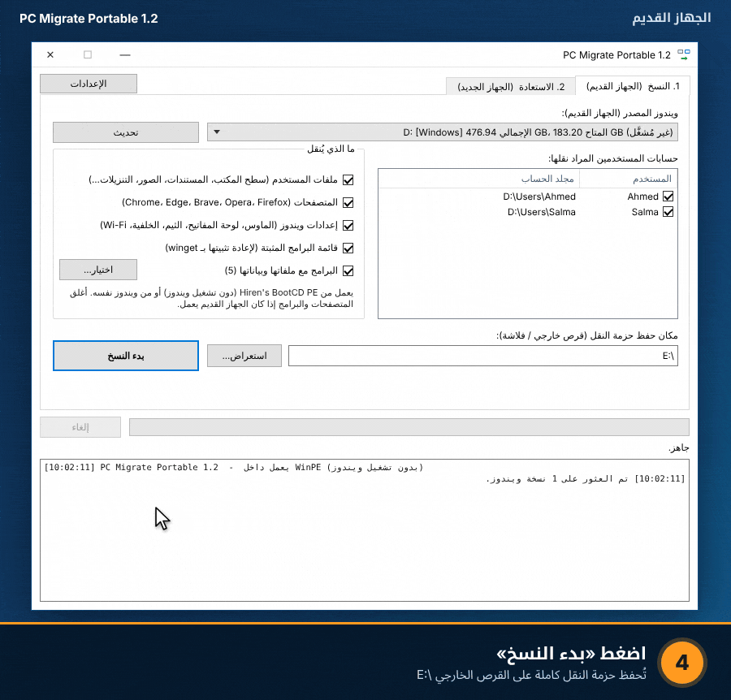
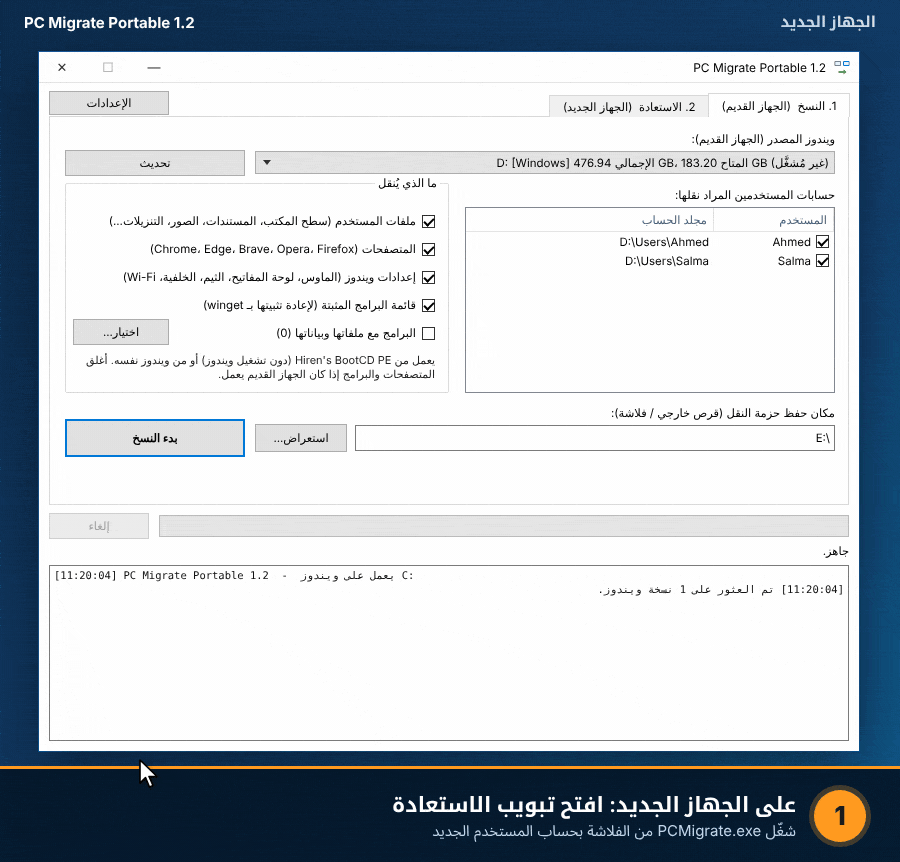
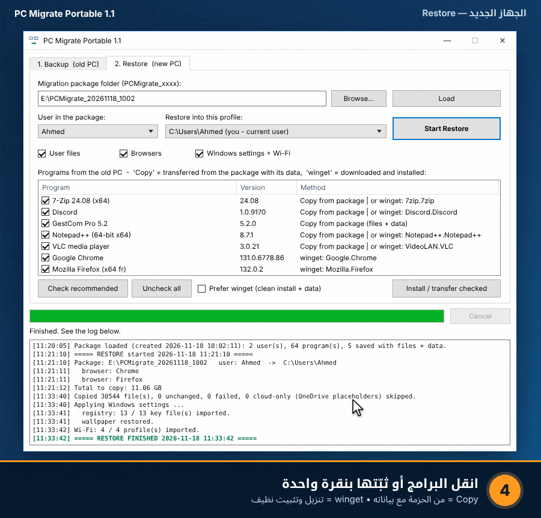
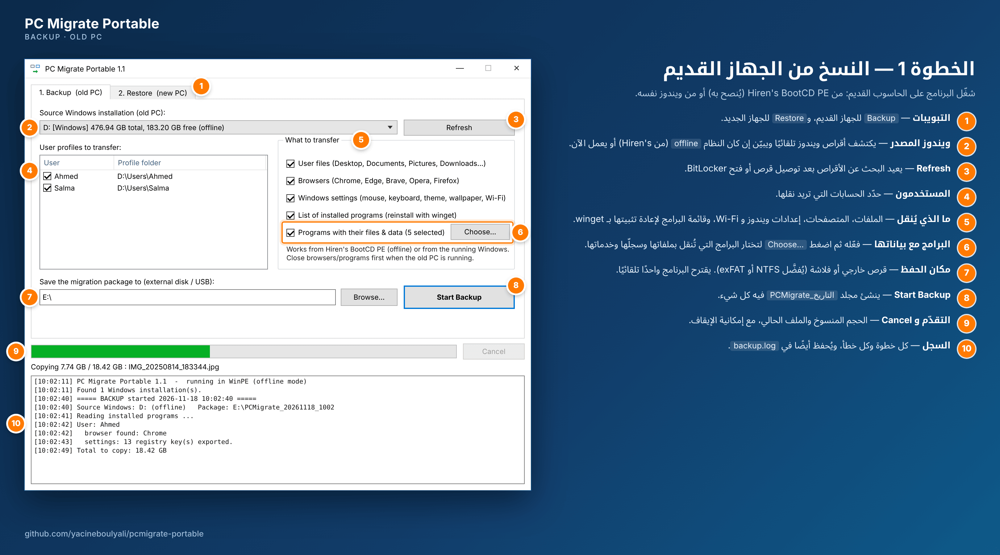
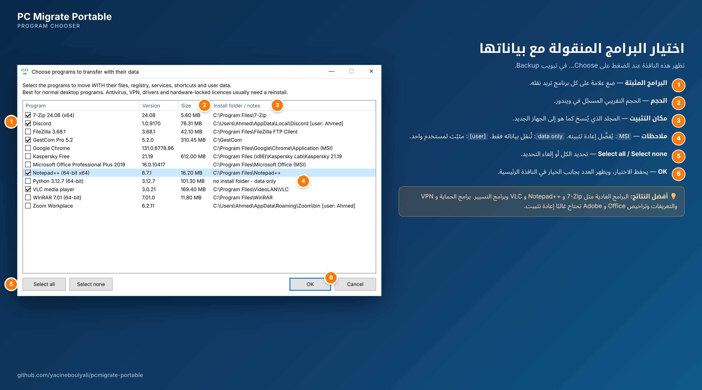
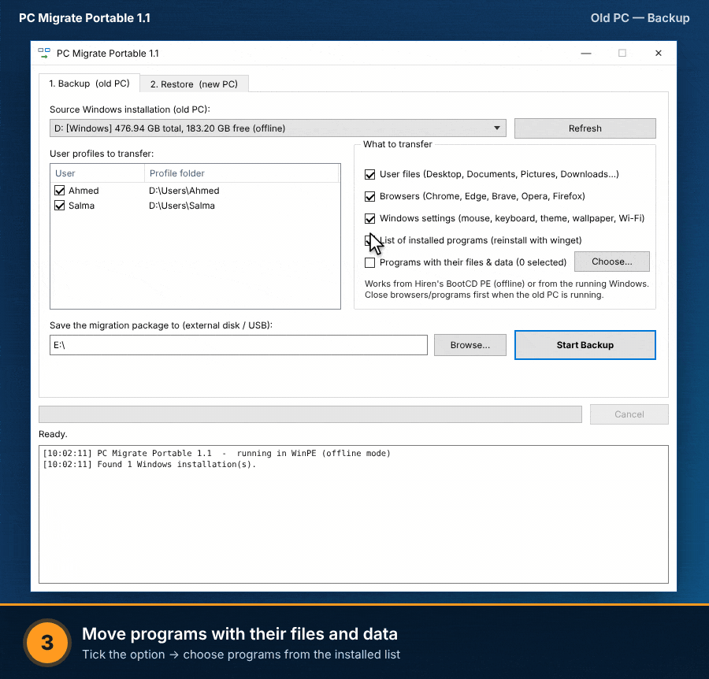
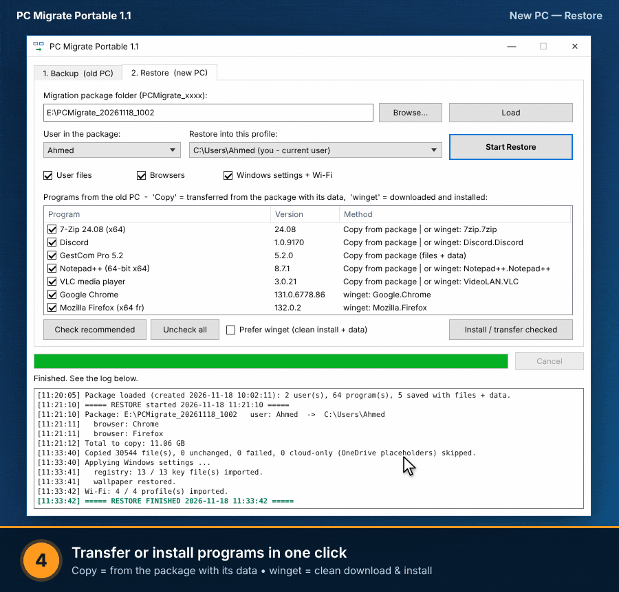
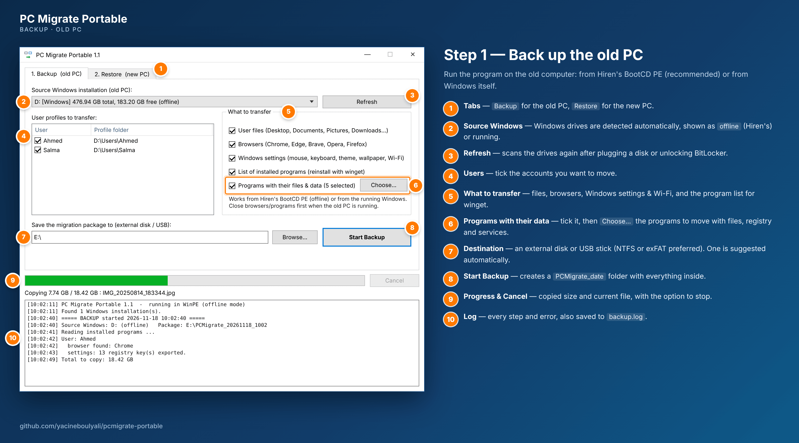

<p align="center">
  
</p>

<h1 align="center">PC Migrate Portable</h1>

<p align="center">
  <a href="#lang-ar"></a>
  &nbsp;
  <a href="#lang-en"></a>
  &nbsp;
  <a href="https://yacineboulyali.github.io/pcmigrate-portable/"></a>
</p>

<p align="center">
  <a href="https://github.com/yacineboulyali/pcmigrate-portable/releases/latest"></a>
  <a href="https://github.com/yacineboulyali/pcmigrate-portable/actions"></a>
  
  
</p>

---

<a id="lang-ar"></a>
<details open>
<summary><h2>🟠 العربية — اضغط لعرض الشرح بالصور المتحركة</h2></summary>

<div dir="rtl">

أداة مجانية ومحمولة تنقل **الملفات والمتصفحات وإعدادات ويندوز والبرامج المثبتة مع بياناتها** من حاسوب قديم إلى حاسوب جديد. تعمل على Windows 10/11 وداخل **Hiren's BootCD PE**.

### ⬇️ التحميل

| الملف | الاستعمال |
|---|---|
| [**PCMigrate-Setup-1.1.0.exe**](https://github.com/yacineboulyali/pcmigrate-portable/releases/latest/download/PCMigrate-Setup-1.1.0.exe) | ملف تثبيت عادي |
| [**PCMigrate-Portable-1.1.0.zip**](https://github.com/yacineboulyali/pcmigrate-portable/releases/latest/download/PCMigrate-Portable-1.1.0.zip) | نسخة الفلاشة و Hiren's مع ملفات `.bat` |

> ⚠️ البرنامج غير موقّع رقميًا، فقد يظهر تحذير SmartScreen: اضغط **More info** ثم **Run anyway**.

### 🎬 طريقة العمل خطوة بخطوة

#### 1. يكتشف ويندوز القديم والمستخدمين، فتختار ما تنقله


#### 2. اختر البرامج التي تُنقل مع ملفاتها وبياناتها


#### 3. ابدأ النسخ إلى القرص الخارجي


#### 4. على الجهاز الجديد: استعد الملفات والمتصفحات والإعدادات


#### 5. انقل البرامج أو ثبّتها بنقرة واحدة، ثم أعد تشغيل الجهاز


### 🖱️ شرح كل الأزرار





الدليل الكامل والحدود: [docs/README_AR.md](docs/README_AR.md)

</div>
</details>

---

<a id="lang-en"></a>
<details>
<summary><h2>🔵 English — click to show the animated guide</h2></summary>

A free, portable tool that moves **files, browsers, Windows settings and installed programs with their data** from an old PC to a new one. Runs on Windows 10/11 and inside **Hiren's BootCD PE**.

### ⬇️ Download

| File | Use |
|---|---|
| [**PCMigrate-Setup-1.1.0.exe**](https://github.com/yacineboulyali/pcmigrate-portable/releases/latest/download/PCMigrate-Setup-1.1.0.exe) | Regular installer |
| [**PCMigrate-Portable-1.1.0.zip**](https://github.com/yacineboulyali/pcmigrate-portable/releases/latest/download/PCMigrate-Portable-1.1.0.zip) | USB / Hiren's version with `.bat` launchers |

> ⚠️ The program is not digitally signed, so SmartScreen may warn you: click **More info** then **Run anyway**.

### 🎬 How it works, step by step

#### 1. Detects the old Windows and its users — choose what to move


#### 2. Choose programs to move with their files and data


#### 3. Start the backup to the external disk


#### 4. On the new PC: restore files, browsers and settings


#### 5. Transfer or install programs in one click, then restart


### 🖱️ Every button explained




</details>

---

## 🛠️ Build from source

```sh
sudo apt install g++-mingw-w64-x86-64 nsis zip
./build.sh      # build/PCMigrate.exe
./package.sh    # dist/: Setup + Portable zip
```

On Windows: `build.bat` with MSYS2 / MinGW-w64. Every push to `main` is built by GitHub Actions and published as release `v<VERSION>`.

<p align="center">MIT License © 2026 Yacine Boulyali</p>
