<p align="center">
  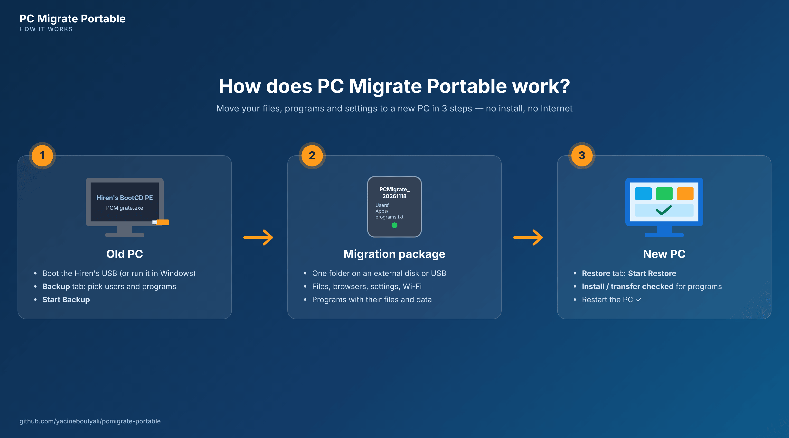
</p>

<h1 align="center">PC Migrate Portable</h1>

<p align="center">
  <b>Move your old PC to a new one — files, browsers, Windows settings and installed programs with their data.</b><br>
  Portable · Runs from Hiren's BootCD PE · English · Français · العربية · Español
</p>

<p align="center">
  <a href="#english"></a>
  <a href="#francais"></a>
  <a href="#arabic"></a>
  <a href="#espanol"></a>
  <a href="https://yacineboulyali.github.io/pcmigrate-portable/"></a>
</p>

<p align="center">
  <a href="https://github.com/yacineboulyali/pcmigrate-portable/releases/latest"></a>
  <a href="https://github.com/yacineboulyali/pcmigrate-portable/actions"></a>
  
  
</p>

<p align="center">
  <a href="https://github.com/yacineboulyali/pcmigrate-portable/releases/latest/download/PCMigrate-Setup.exe"><b>⬇ PCMigrate-Setup.exe</b></a> &nbsp;·&nbsp;
  <a href="https://github.com/yacineboulyali/pcmigrate-portable/releases/latest/download/PCMigrate-Portable.zip"><b>⬇ PCMigrate-Portable.zip</b></a> &nbsp;·&nbsp;
  <a href="https://github.com/yacineboulyali/pcmigrate-portable/releases/latest/download/PCMigrate.exe">PCMigrate.exe</a>
</p>

---

<a id="english"></a>
<details open>
<summary><h2>🇬🇧 English</h2></summary>

**PC Migrate Portable** is a free, open-source tool that moves everything from an old Windows PC to a new one — like PCmover, but portable and free. It is a single ~500 KB executable with no runtime to install, and it also runs from a **Hiren's BootCD PE** USB stick, even when the old Windows no longer boots.

### ✨ Features
- **User files** — Desktop, Documents, Pictures, Downloads, Music, Videos… (OneDrive folders included)
- **Browsers** — Chrome, Edge, Brave, Opera and Firefox profiles: bookmarks, history, extensions
- **Windows settings** — mouse, keyboard & languages, regional format, dark mode, wallpaper, Quick Access, **Wi-Fi**
- **Programs with their data** — program files, registry, services, Start-menu shortcuts and each user's AppData
- **Clean reinstall with winget** — or "winget + data": clean install, then the program's settings are restored
- **4 interface languages** — English, Français, العربية (right-to-left), Español — change it any time in **Settings**

### ⬇️ Download
| File | Use |
|---|---|
| [**PCMigrate-Setup.exe**](https://github.com/yacineboulyali/pcmigrate-portable/releases/latest/download/PCMigrate-Setup.exe) | Installer (Start-menu shortcut, uninstaller). The installer language becomes the app language. |
| [**PCMigrate-Portable.zip**](https://github.com/yacineboulyali/pcmigrate-portable/releases/latest/download/PCMigrate-Portable.zip) | For a USB stick / Hiren's: `PCMigrate.exe` + `Run-PCMigrate.bat` + `Copy-To-USB.bat` |

> ⚠️ Not digitally signed: if SmartScreen warns you, click **More info → Run anyway**.

### 🎬 How it works
**1. Detects the old Windows and its users — choose what to move**<br>
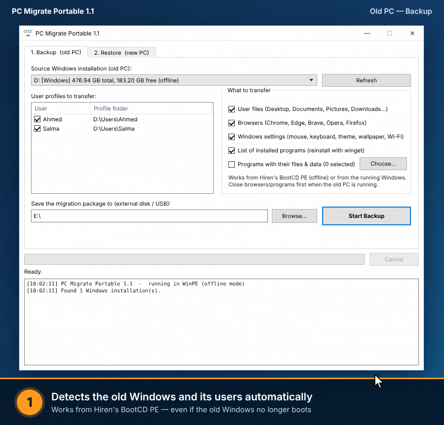

**2. Choose programs to move with their files and data**<br>


**3. Start the backup to an external disk**<br>
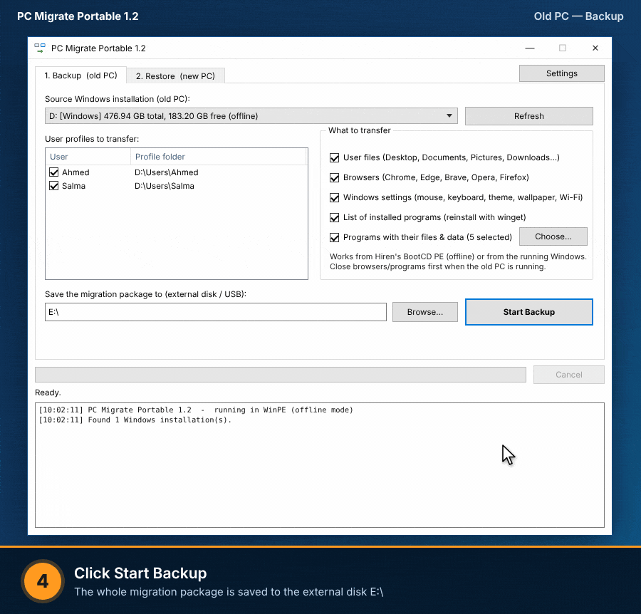

**4. On the new PC: restore files, browsers and settings**<br>
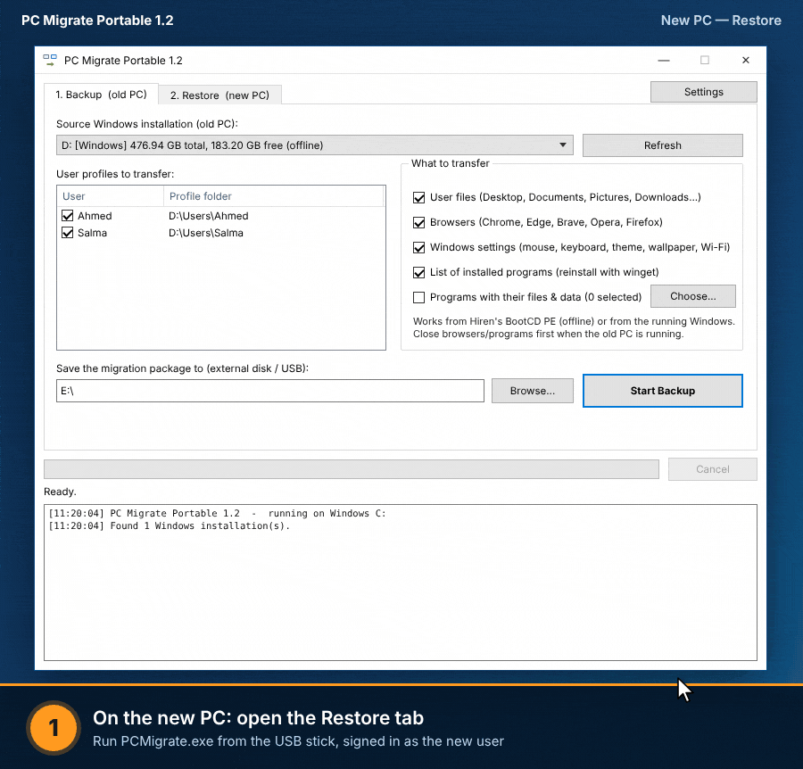

**5. Transfer or install programs in one click, then restart**<br>


### 🖱️ Every button explained

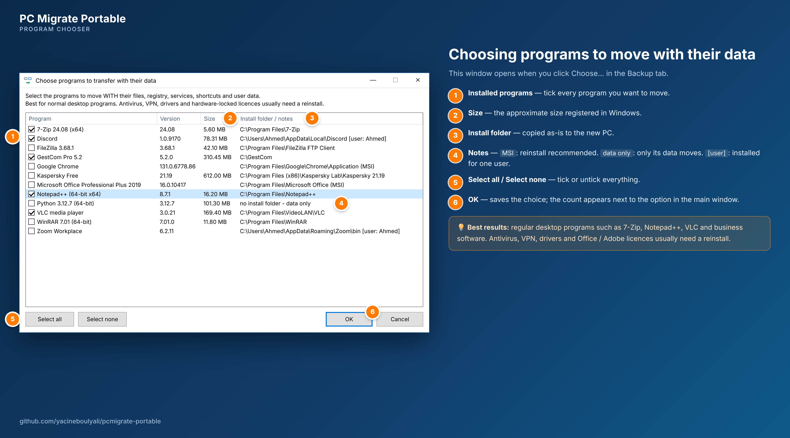
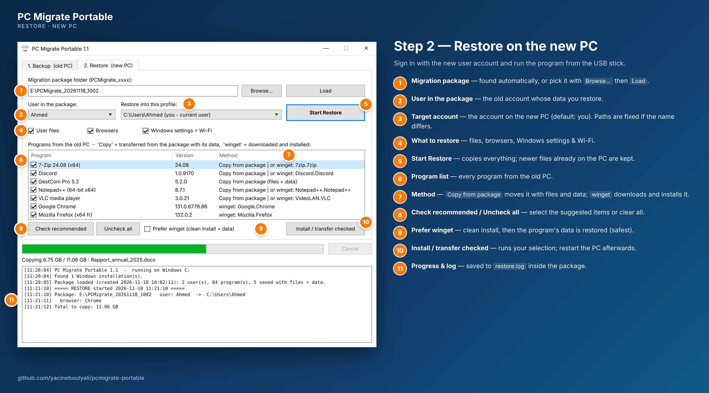

### ⚙️ Settings & language
Click **Settings** (top-right) to switch between English, Français, العربية and Español. The window reloads instantly; the choice is saved in `PCMigrate.ini` next to the program. You can also start it with `PCMigrate.exe --lang=fr` (`en`, `fr`, `ar`, `es`).

### ⚠️ Good to know
- Chrome / Edge / Brave / Opera **passwords and cookies** are encrypted per PC — use browser sync. Firefox moves completely.
- Antivirus, VPN, drivers and Office / Adobe licences usually need a reinstall.
- Wi-Fi passwords move when the backup is taken from the running Windows; from Hiren's only network names move.
- Try it in a virtual machine first, and use an NTFS or exFAT disk.

</details>

<a id="francais"></a>
<details>
<summary><h2>🇫🇷 Français</h2></summary>

**PC Migrate Portable** est un outil gratuit et open source qui transfère tout le contenu d'un ancien PC Windows vers un nouveau — comme PCmover, mais portable et gratuit. Un seul exécutable d'environ 500 Ko, sans rien à installer, qui fonctionne aussi depuis une clé **Hiren's BootCD PE**, même si l'ancien Windows ne démarre plus.

### ✨ Fonctionnalités
- **Fichiers** — Bureau, Documents, Images, Téléchargements, Musique, Vidéos… (dossiers OneDrive compris)
- **Navigateurs** — profils Chrome, Edge, Brave, Opera et Firefox : favoris, historique, extensions
- **Paramètres Windows** — souris, clavier et langues, format régional, mode sombre, fond d'écran, Accès rapide, **Wi-Fi**
- **Programmes avec leurs données** — fichiers du programme, registre, services, raccourcis et AppData de chaque utilisateur
- **Réinstallation propre via winget** — ou « winget + données » : installation propre puis restauration des réglages du programme
- **4 langues d'interface** — English, Français, العربية, Español — modifiable à tout moment dans **Paramètres**

### ⬇️ Téléchargement
| Fichier | Utilisation |
|---|---|
| [**PCMigrate-Setup.exe**](https://github.com/yacineboulyali/pcmigrate-portable/releases/latest/download/PCMigrate-Setup.exe) | Installateur (raccourcis, désinstallation). La langue de l'installateur devient celle du programme. |
| [**PCMigrate-Portable.zip**](https://github.com/yacineboulyali/pcmigrate-portable/releases/latest/download/PCMigrate-Portable.zip) | Pour clé USB / Hiren's : `PCMigrate.exe` + `Run-PCMigrate.bat` + `Copy-To-USB.bat` |

> ⚠️ Non signé numériquement : si SmartScreen vous avertit, cliquez sur **Informations complémentaires → Exécuter quand même**.

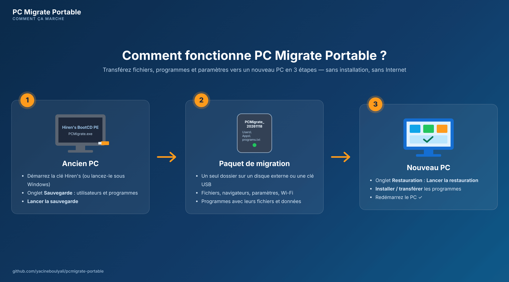

### 🎬 Fonctionnement étape par étape
**1. Détecte l'ancien Windows et ses utilisateurs — choisissez quoi transférer**<br>
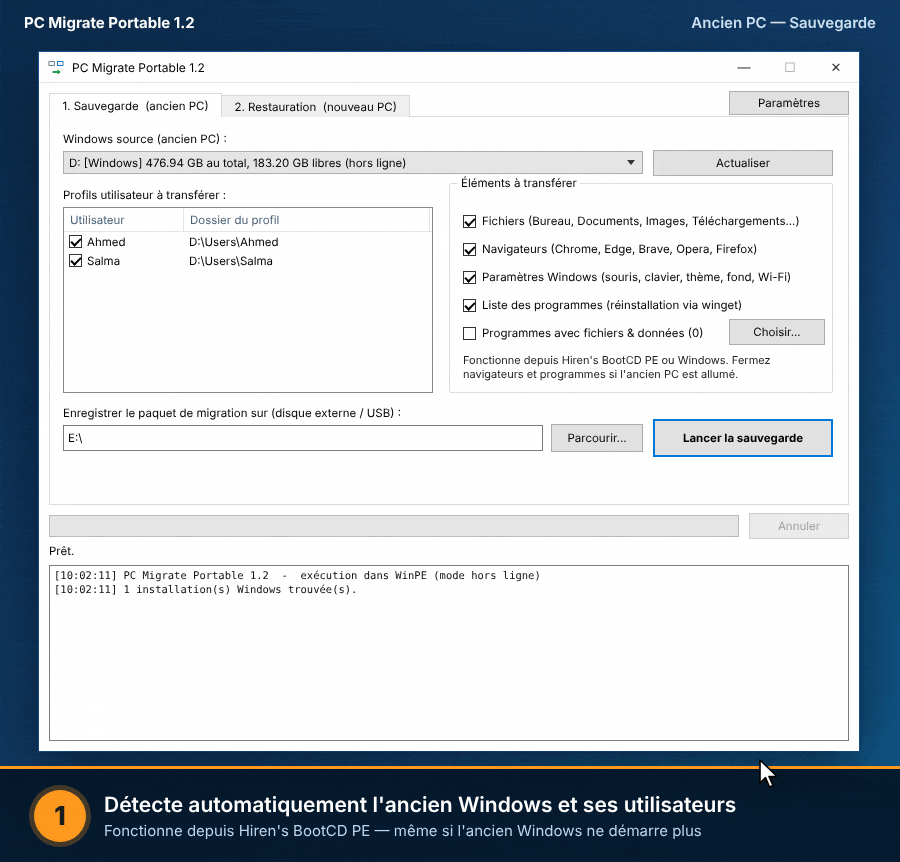

**2. Choisissez les programmes à déplacer avec leurs fichiers et données**<br>
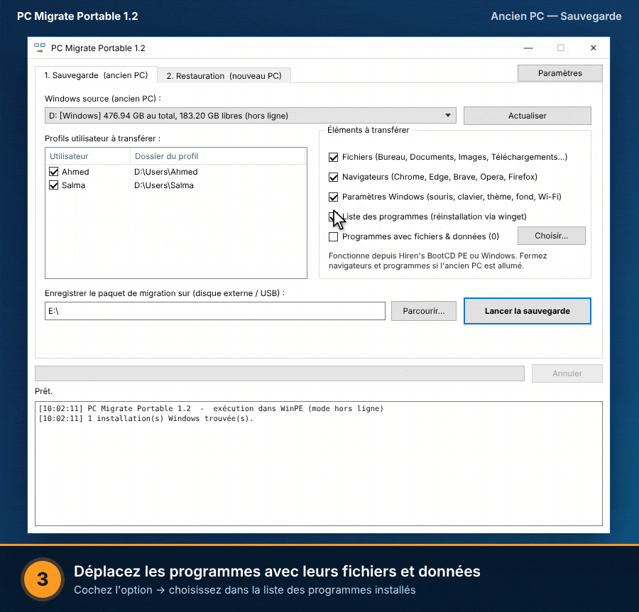

**3. Lancez la sauvegarde vers un disque externe**<br>
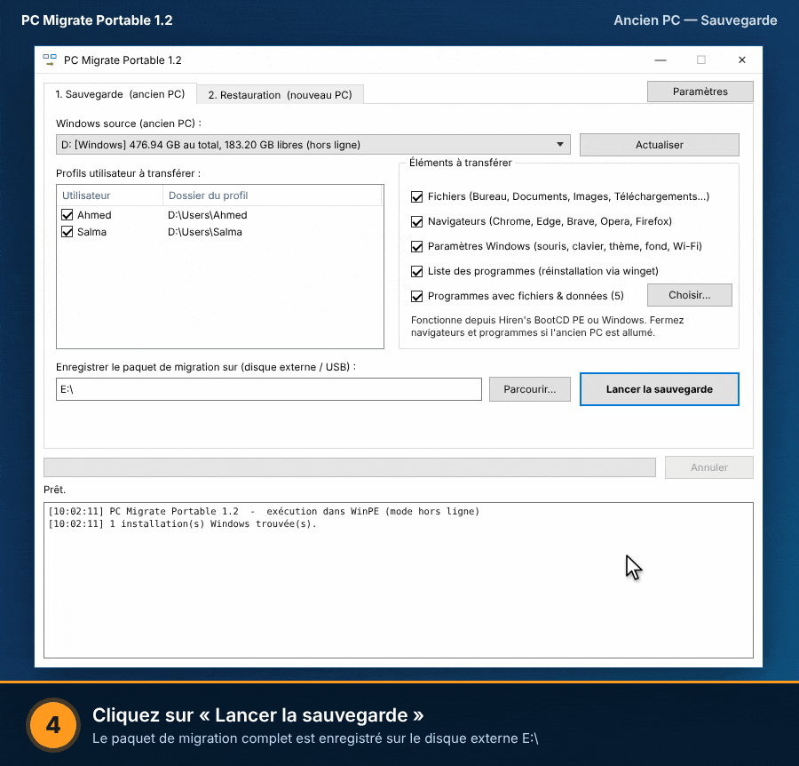

**4. Sur le nouveau PC : restaurez fichiers, navigateurs et paramètres**<br>
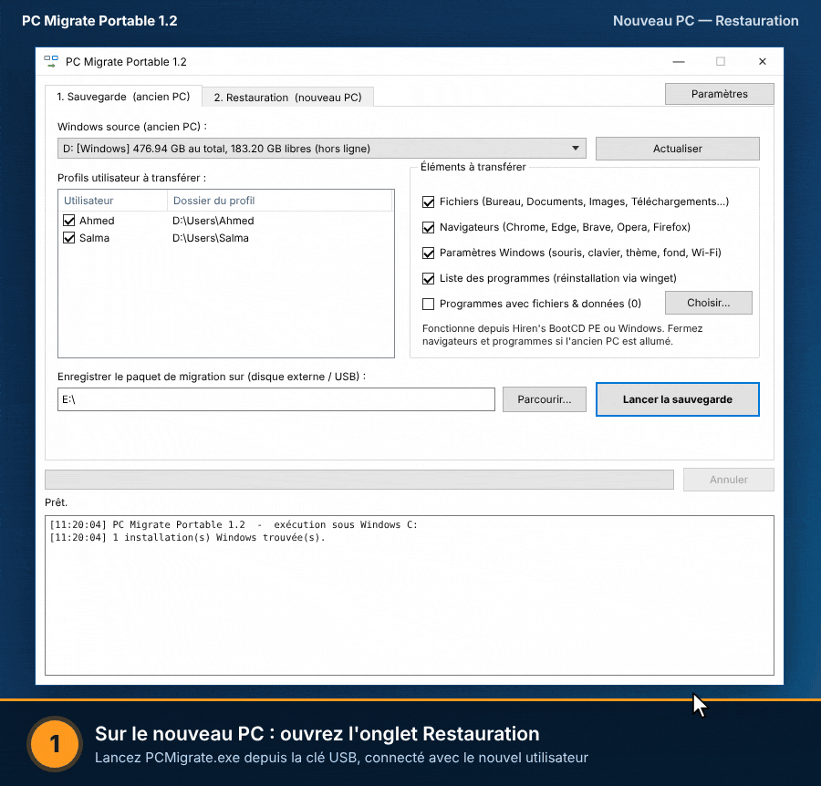

**5. Transférez ou installez les programmes en un clic, puis redémarrez**<br>
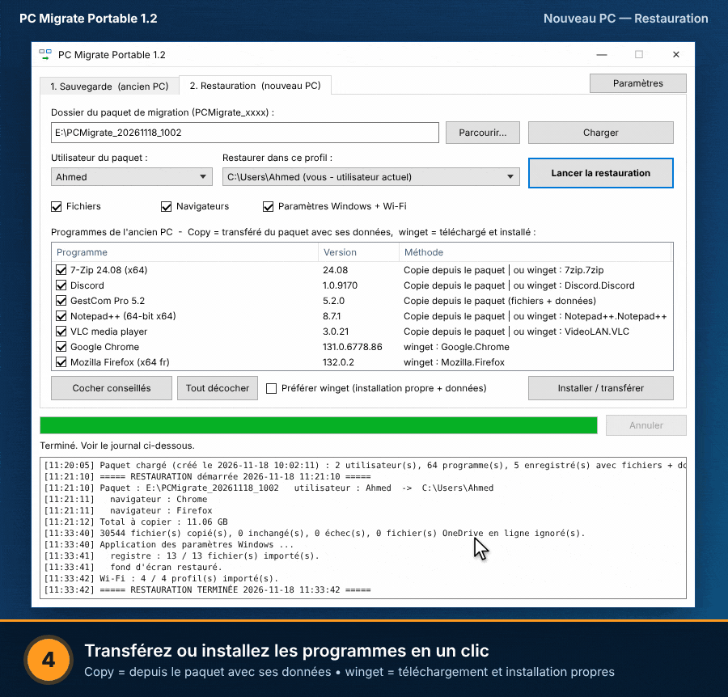

### ⚙️ Paramètres et langue
Cliquez sur **Paramètres** (en haut à droite) pour choisir English, Français, العربية ou Español. La fenêtre se recharge immédiatement ; le choix est enregistré dans `PCMigrate.ini` à côté du programme. Option en ligne de commande : `PCMigrate.exe --lang=fr`.

### ⚠️ À savoir
- Les **mots de passe et cookies** de Chrome / Edge / Brave / Opera sont chiffrés par PC : utilisez la synchronisation du navigateur. Firefox est transféré entièrement.
- Antivirus, VPN, pilotes et licences Office / Adobe demandent généralement une réinstallation.
- Les mots de passe Wi-Fi sont transférés si la sauvegarde est faite depuis Windows démarré ; depuis Hiren's, seuls les noms des réseaux le sont.
- Testez d'abord dans une machine virtuelle et utilisez un disque NTFS ou exFAT.

</details>

<a id="arabic"></a>
<details>
<summary><h2>🌍 العربية</h2></summary>

<div dir="rtl">

**PC Migrate Portable** أداة مجانية ومفتوحة المصدر تنقل كل شيء من حاسوب ويندوز قديم إلى حاسوب جديد، على طريقة PCmover لكنها محمولة ومجانية. ملف واحد حجمه حوالي 500 KB لا يحتاج تثبيت أي مكتبة، ويعمل أيضًا من فلاشة **Hiren's BootCD PE** حتى لو كان ويندوز القديم لا يُقلع.

### ✨ المميزات
- **ملفات المستخدم:** سطح المكتب، المستندات، الصور، التنزيلات، الموسيقى، الفيديو... مع مجلدات OneDrive
- **المتصفحات:** Chrome و Edge و Brave و Opera و Firefox: المفضلة والسجل والإضافات
- **إعدادات ويندوز:** الماوس، لوحة المفاتيح واللغات، الإعدادات الإقليمية، الوضع الداكن، الخلفية، الوصول السريع، **Wi-Fi**
- **البرامج مع بياناتها:** ملفات البرنامج، السجل (Registry)، الخدمات، الاختصارات، وبيانات كل مستخدم
- **إعادة تثبيت نظيفة عبر winget:** أو «winget + البيانات»، أي تثبيت نظيف ثم استرجاع إعدادات البرنامج
- **4 لغات للواجهة:** English و Français و العربية (من اليمين إلى اليسار) و Español، ويمكن تغييرها في أي وقت من **الإعدادات**

### ⬇️ التحميل
| الملف | الاستعمال |
|---|---|
| [**PCMigrate-Setup.exe**](https://github.com/yacineboulyali/pcmigrate-portable/releases/latest/download/PCMigrate-Setup.exe) | ملف تثبيت (اختصارات وإمكانية الإزالة)، ولغة التثبيت تصبح لغة البرنامج |
| [**PCMigrate-Portable.zip**](https://github.com/yacineboulyali/pcmigrate-portable/releases/latest/download/PCMigrate-Portable.zip) | للفلاشة و Hiren's: `PCMigrate.exe` و `Run-PCMigrate.bat` و `Copy-To-USB.bat` |

> ⚠️ البرنامج غير موقّع رقميًا، فإذا ظهر تحذير SmartScreen اضغط **More info** ثم **Run anyway**.

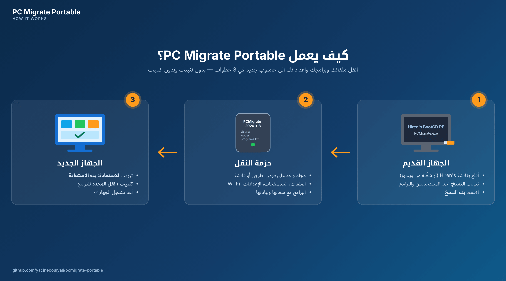

### 🎬 طريقة العمل خطوة بخطوة
**1. يكتشف ويندوز القديم والمستخدمين، فتختار ما تنقله**<br>
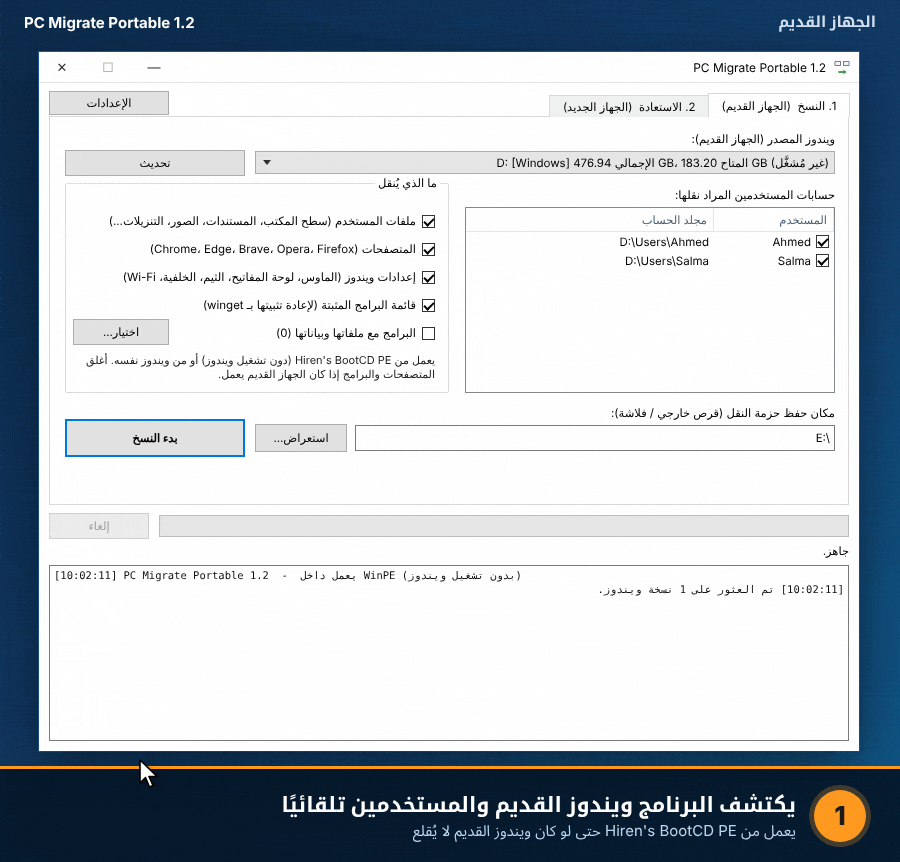

**2. اختر البرامج التي تُنقل مع ملفاتها وبياناتها**<br>
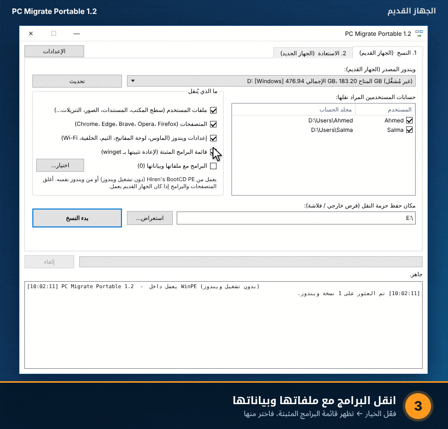

**3. ابدأ النسخ إلى قرص خارجي**<br>


**4. على الجهاز الجديد: استعد الملفات والمتصفحات والإعدادات**<br>


**5. انقل البرامج أو ثبّتها بنقرة واحدة، ثم أعد تشغيل الجهاز**<br>


### 🖱️ شرح كل الأزرار


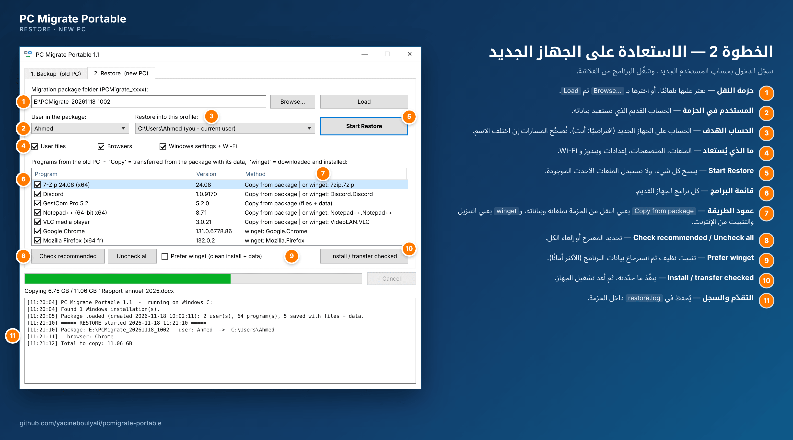

### ⚙️ الإعدادات واللغة
اضغط زر **الإعدادات** في أعلى النافذة لتختار English أو Français أو العربية أو Español. تُعاد تهيئة النافذة فورًا، ويُحفظ الاختيار في ملف `PCMigrate.ini` بجانب البرنامج. ويمكن أيضًا تشغيله بالأمر `PCMigrate.exe --lang=ar`.

### ⚠️ حدود يجب معرفتها
- **كلمات المرور والكوكيز** في Chrome و Edge و Brave و Opera مشفّرة لكل جهاز، فاستعمل المزامنة. أما Firefox فينتقل بالكامل.
- برامج الحماية و VPN والتعريفات وتراخيص Office و Adobe تحتاج غالبًا إعادة تثبيت.
- كلمات مرور Wi-Fi تنتقل إذا أُخذت النسخة من ويندوز وهو يعمل، أما من Hiren's فتنتقل أسماء الشبكات فقط.
- جرّب البرنامج أولًا على جهاز وهمي (VM)، واستعمل قرصًا بصيغة NTFS أو exFAT.

</div>
</details>

<a id="espanol"></a>
<details>
<summary><h2>🇪🇸 Español</h2></summary>

**PC Migrate Portable** es una herramienta gratuita y de código abierto que pasa todo de un PC con Windows antiguo a uno nuevo — como PCmover, pero portátil y gratis. Un solo ejecutable de unos 500 KB, sin nada que instalar, que también funciona desde un USB de **Hiren's BootCD PE**, incluso si el Windows antiguo ya no arranca.

### ✨ Funciones
- **Archivos** — Escritorio, Documentos, Imágenes, Descargas, Música, Vídeos… (incluidas las carpetas de OneDrive)
- **Navegadores** — perfiles de Chrome, Edge, Brave, Opera y Firefox: marcadores, historial, extensiones
- **Ajustes de Windows** — ratón, teclado e idiomas, formato regional, modo oscuro, fondo, Acceso rápido, **Wi-Fi**
- **Programas con sus datos** — archivos del programa, registro, servicios, accesos directos y AppData de cada usuario
- **Reinstalación limpia con winget** — o «winget + datos»: instalación limpia y luego se restauran los ajustes del programa
- **4 idiomas de interfaz** — English, Français, العربية, Español — se puede cambiar en cualquier momento en **Ajustes**

### ⬇️ Descarga
| Archivo | Uso |
|---|---|
| [**PCMigrate-Setup.exe**](https://github.com/yacineboulyali/pcmigrate-portable/releases/latest/download/PCMigrate-Setup.exe) | Instalador (accesos directos, desinstalador). El idioma del instalador pasa a ser el del programa. |
| [**PCMigrate-Portable.zip**](https://github.com/yacineboulyali/pcmigrate-portable/releases/latest/download/PCMigrate-Portable.zip) | Para USB / Hiren's: `PCMigrate.exe` + `Run-PCMigrate.bat` + `Copy-To-USB.bat` |

> ⚠️ Sin firma digital: si SmartScreen te avisa, pulsa **Más información → Ejecutar de todas formas**.

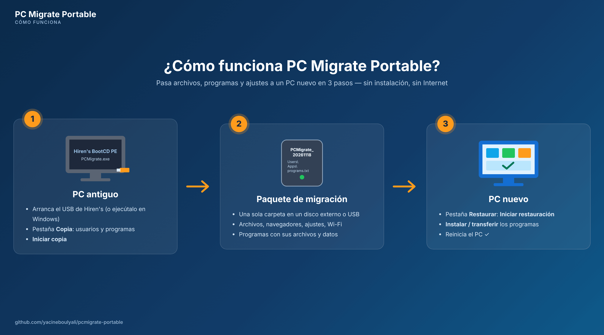

### 🎬 Cómo funciona, paso a paso
**1. Detecta el Windows antiguo y sus usuarios — elige qué transferir**<br>
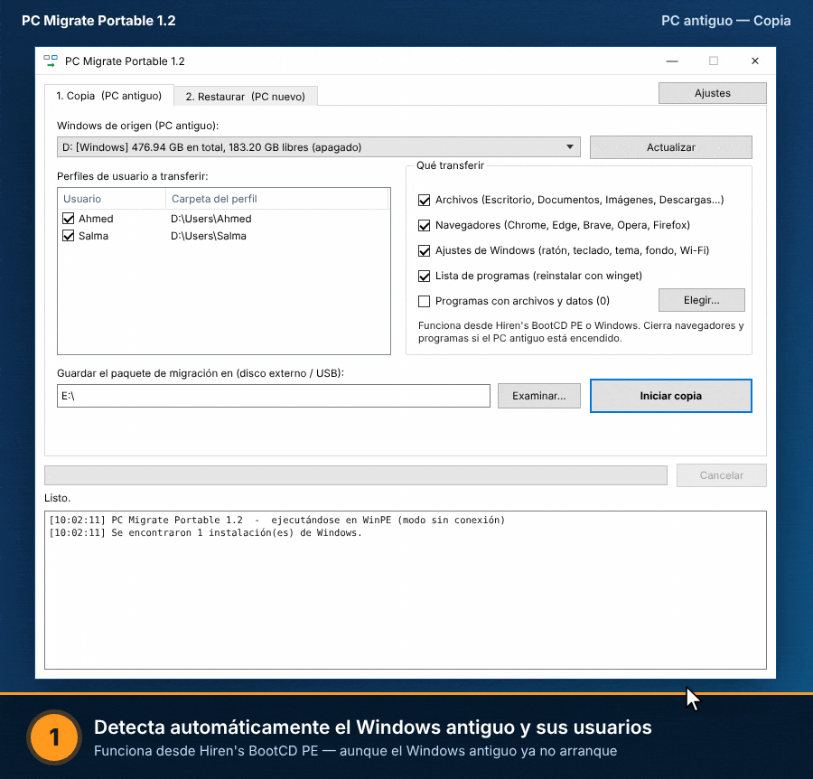

**2. Elige los programas a mover con sus archivos y datos**<br>
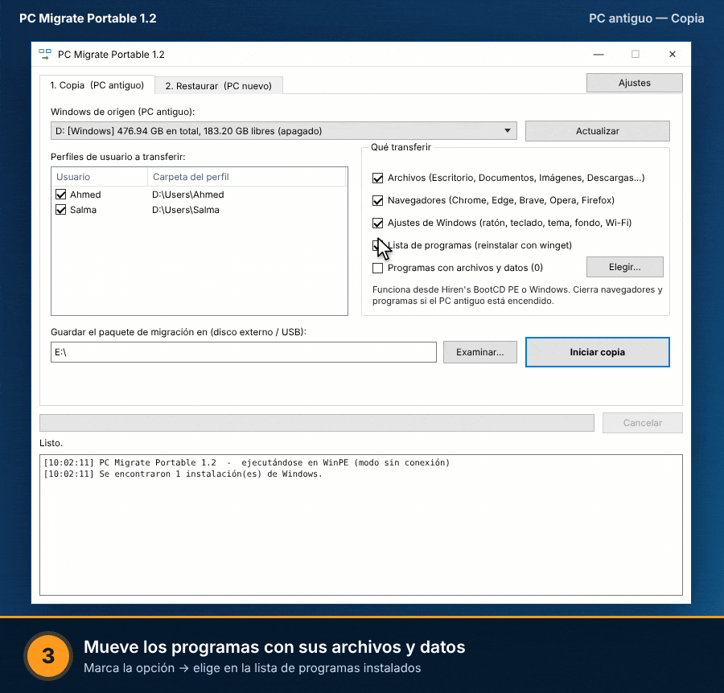

**3. Inicia la copia a un disco externo**<br>
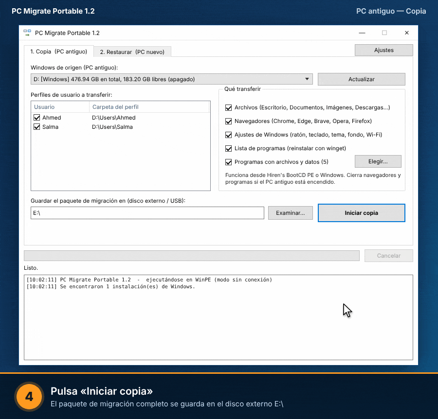

**4. En el PC nuevo: restaura archivos, navegadores y ajustes**<br>
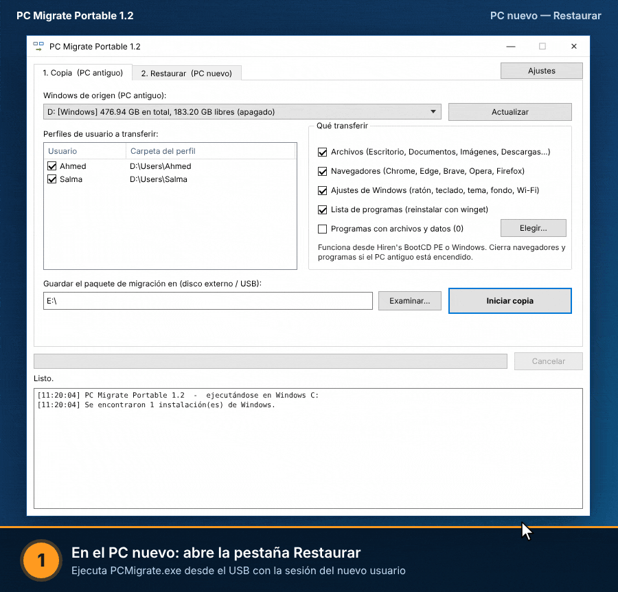

**5. Transfiere o instala los programas con un clic y reinicia**<br>


### ⚙️ Ajustes e idioma
Pulsa **Ajustes** (arriba a la derecha) para elegir English, Français, العربية o Español. La ventana se recarga al instante; la elección se guarda en `PCMigrate.ini` junto al programa. También puedes iniciarlo con `PCMigrate.exe --lang=es`.

### ⚠️ Conviene saber
- Las **contraseñas y cookies** de Chrome / Edge / Brave / Opera están cifradas por PC: usa la sincronización del navegador. Firefox se transfiere por completo.
- Antivirus, VPN, controladores y licencias de Office / Adobe suelen requerir reinstalación.
- Las contraseñas Wi-Fi se transfieren si la copia se hace desde Windows en ejecución; desde Hiren's solo se pasan los nombres de las redes.
- Pruébalo primero en una máquina virtual y usa un disco NTFS o exFAT.

</details>

---

## 🛠️ Build from source

```sh
sudo apt install g++-mingw-w64-x86-64 nsis zip
python3 tools/i18n/gen_strings.py   # translations -> src/strings.h
./build.sh                          # build/PCMigrate.exe
./package.sh                        # dist/: PCMigrate-Setup.exe + PCMigrate-Portable.zip
```

Translations live in [`tools/i18n/strings.py`](tools/i18n/strings.py) (English, French, Arabic, Spanish). Every push to `main` is built by GitHub Actions and published as release `v<VERSION>`.

<p align="center">MIT License © 2026 Yacine Boulyali</p>
